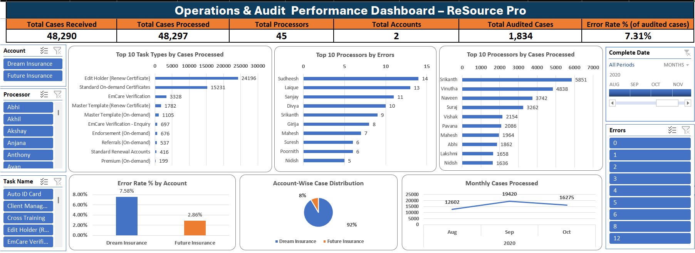

# 💼 Operations & Audit Performance Dashboard

An Excel-based dashboard created to analyze case processing and audit performance using operational and audit data.

## Dashboard Highlights

| Metric | Value |
| --- | ---: |
| Total Cases Received | **48,290** |
| Total Cases Processed | **48,297** |
| Total Processors | **45** |
| Total Accounts | **2** |
| Total Audited Cases | **1,834** |
| Total Errors Found | **134** |
| Error Rate (of audited cases) | **7.31%** |

**How the error rate is calculated:** Error Rate = Total Errors ÷ Total Audited Cases = 134 ÷ 1,834 = 7.31%. Errors are only found in audited cases, so the rate is measured on audited cases and not on all processed cases.

## Analysis Included

* Monthly Cases Processed
* Top 10 Processors by Cases Processed
* Top 10 Processors by Errors
* Top 10 Task Types by Cases Processed
* Account-Wise Case Distribution
* Error Rate % by Account

## Filters & Slicers

* Account
* Processor
* Task Name
* Complete Date (timeline)
* Errors

## Workbook Structure

Workbook file: `ShreyaThaware_Analyst_File.xlsx.xlsm`

* `Raw Data 1` – Operational case processing data
* `Raw Data 2` – Audit data
* `Pivot Tables` – Pivot-based analysis supporting the dashboard
* `Dashboard` – Interactive Operations & Audit Performance Dashboard

## Key Results

### Monthly Cases Processed

| Month          | Cases Processed |
| -------------- | --------------: |
| August 2020    |          12,602 |
| September 2020 |          19,420 |
| October 2020   |          16,275 |

### Error Rate by Account

| Account          | Error Rate (of audited cases) |
| ---------------- | ----------------------------: |
| Dream Insurance  |                         7.58% |
| Future Insurance |                         2.86% |

## Data Notes

* **Processed is 7 higher than Received (48,297 vs 48,290).** This comes from one record in the source data (a cross-training case) that is logged as 3 received and 10 processed. All other records match.
* **Audit period vs processing period.** Case processing data covers August–October 2020. The audit data also includes audit records dated July–October 2021, so the error rate is calculated on all audit records in the file.
* **Errors can be higher than audited cases.** Six audit records show more errors than audited cases (for example, 1 audited and 4 errors), because one audited case can have more than one error. These records are kept as they are in the source data.

## Tools & Features

* Microsoft Excel (macro-enabled workbook, `.xlsm`)
* PivotTables and Pivot Charts
* Slicers and Timeline
* Excel Formulas (`GETPIVOTDATA`, `COUNTA`, `UNIQUE`, `SUM`)
* Dashboard Design and KPI Cards

## Screenshot Of Dashboard

